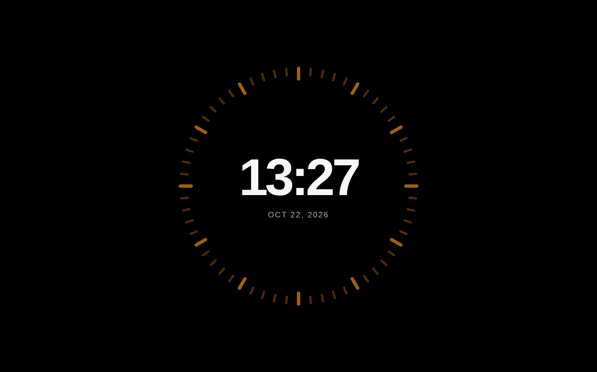
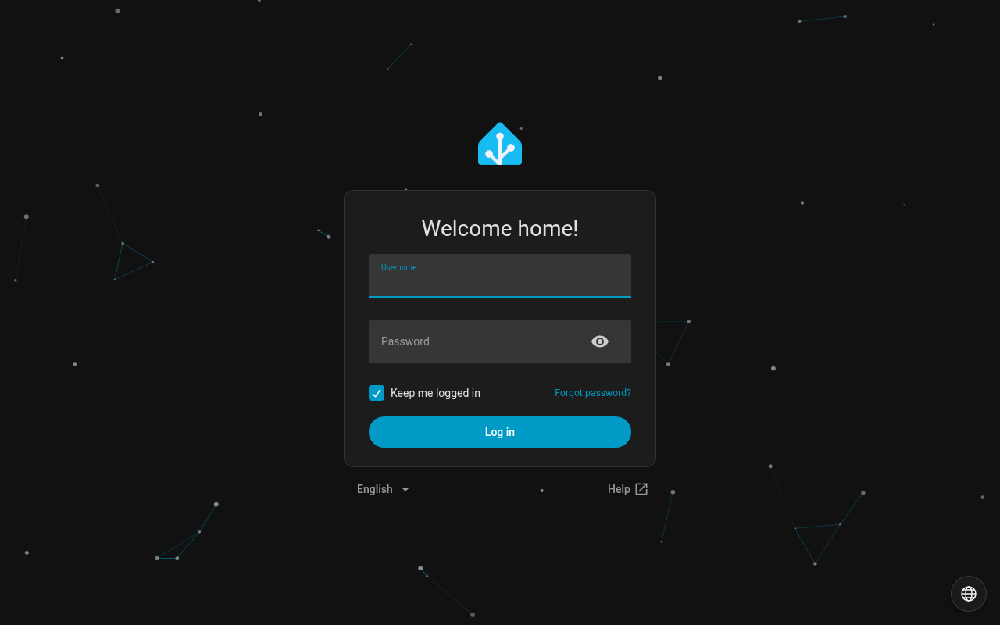
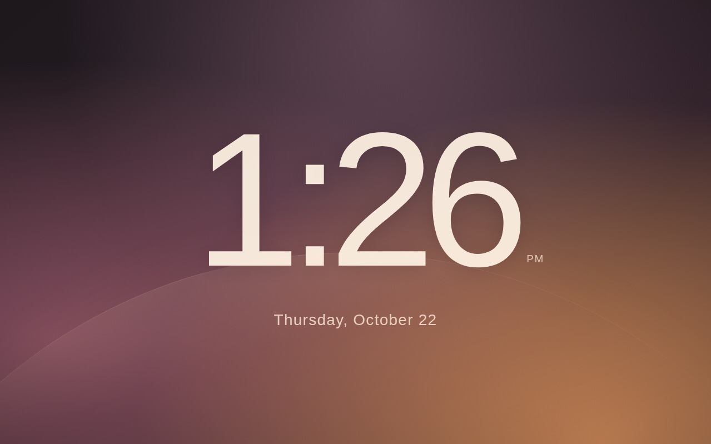
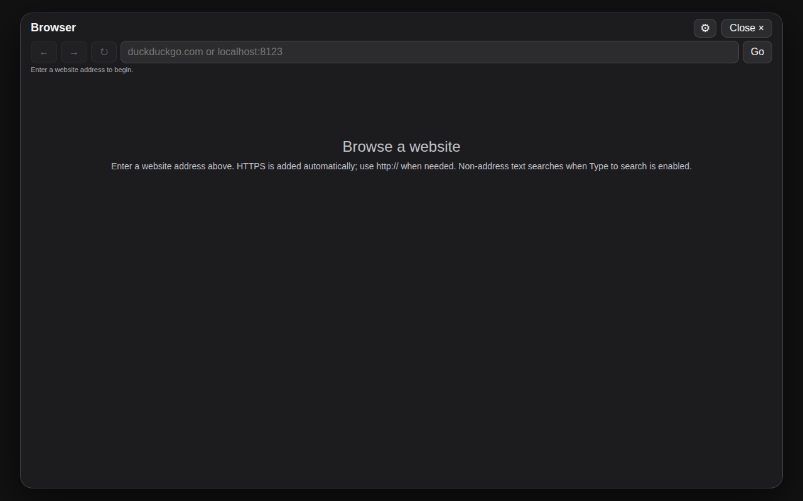

# HA View

HA View turns a Home Assistant dashboard into a touch-friendly, fullscreen display, with a clock or calendar face ready when the screen is idle. It builds on [TouchKio](https://github.com/leukipp/touchkio), bringing its dashboard, browser and MQTT foundations into an Electron app.

> HA View is an independent project and is not affiliated with Apple.

## Downloads

**HA View 0.40.0** — pick your platform:

| Platform | Download |
| --- | --- |
| Linux x64 kiosk | [tar.gz](https://github.com/rommeltrejo/home-assistant-view/releases/download/0.40.0/ha.view-0.40.0-linux-x64-kiosk.tar.gz) |
| Windows x64 portable | [ZIP](https://github.com/rommeltrejo/home-assistant-view/releases/download/0.40.0/ha.view-0.40.0-win32-x64-portable.zip) |
| macOS Apple silicon | [ZIP](https://github.com/rommeltrejo/home-assistant-view/releases/download/0.40.0/ha.view-0.40.0-darwin-arm64.zip) |

Download, unzip, and follow the short steps for your platform below. The first time HA View opens, it asks for your Home Assistant address; after that it opens straight to your dashboard.

## Explore HA View

Connect to your dashboard, then choose what to show when the display is idle. The [screen guide](docs/README.md) covers setup, Home Assistant, faces, the browser, and settings. Images show the desktop interface; appearance may vary by platform.

### Home Assistant dashboard

Your existing Home Assistant dashboard stays at the center of HA View. Use its cards and navigation as you normally would.

[Using your dashboard](docs/HA/README.md)

### Idle faces

Choose between two clocks, Calendar, Upcoming Events, and Weather. Press and hold to open the face chooser, then swipe and tap a face. Calendar and Upcoming Events use calendars available to your Home Assistant account; Weather uses a configured Home Assistant weather entity.

[Choosing a face](docs/faces/README.md) · [Face settings and schedules](docs/settings/README.md)

### Browser and Home Assistant tools

Use the built-in browser for a website, or open the Home Assistant shortcuts for devices, entities, scenes, automations, and cameras. What appears depends on your Home Assistant setup.

[Using the browser](docs/browser/README.md) · [Home Assistant dashboard](docs/HA/README.md)

## Windows portable

Extract the **whole ZIP folder** and double-click **Run.cmd**. Nothing to install. The first time it opens, enter your Home Assistant address; your settings are saved for next time. If you start it from a command prompt, `Run.cmd --web-url=http://YOUR-HA:8123/ --app-kiosk=framed` supplies the address up front.

**Install-Kiosk.cmd** and **Update-Kiosk.cmd** are separate, optional tools that set HA View up as a kiosk on this Windows user account: it starts when you log on, and restarts itself if it closes unexpectedly. Running HA View directly with Run.cmd does neither. Keep the separate kiosk folder intact. See `os/windows/portable/README.md`.

## macOS

HA View for Mac comes as an app inside a ZIP file. Unzip it, move **ha.view.app** into your Applications folder, and open it. If macOS asks you to confirm the first time, right-click the app and choose **Open**.

The first time it opens, enter your Home Assistant address and sign in. After that, HA View opens straight to your dashboard, with the same idle faces, browser, and settings as on the other platforms.

## Linux prebuilt

Extract the **whole tar.gz folder**, keeping the files together, then run `./Run.sh` from that folder. Nothing to install, and you can pass options the same way, for example `./Run.sh --web-url=http://YOUR-HA:8123/ --app-kiosk=framed`. You need a graphical Linux desktop. The first time it opens, enter your Home Assistant address, then sign in on Home Assistant's own login screen.

Some Linux desktops restrict how apps like this one are allowed to run, and the extracted copy may refuse to start there. If that happens, do **not** reach for `--no-sandbox` or turn off system security settings — run `./install.sh` from the same folder instead. It installs HA View the standard way (it asks for your normal sudo password), runs it as your own user, and sets it up to start when you log in and to recover from crashes. See `os/linux/kiosk/README.md` for updates, rollback and troubleshooting. Running `./Run.sh` directly does not install anything, and does not restart the app after a crash.

## TouchKio capabilities

HA View builds on TouchKio’s existing browser and MQTT features. Depending on the platform, hardware and MQTT setup, these include touch-focused browsing, page navigation, zoom and themes; screen wake behavior; and remote access to tools such as the on-screen keyboard, display controls, network details, system status and sensors.

MQTT is **off unless you turn it on**. During first-time setup, HA View asks whether you want to connect to an MQTT broker; say yes and enter your broker's address, and the kiosk appears in Home Assistant as a device you can control and read from. If you start HA View from the command line instead, the same choice is `--mqtt-enable` together with `--mqtt-url=mqtt://YOUR-BROKER:1883`. Individual MQTT features can still be turned off with `--app-disable=mqtt_<feature>` (including `mqtt_app` for the app update item).

With MQTT on, the **App** update item in Home Assistant can also install a new version for you. It downloads the new release, checks it against the fingerprint published with it, and installs it the same way the original installer did; on Linux it keeps the previous version, in case you want to roll back. The install option appears when HA View runs from an installed copy, and on Linux it needs password-free sudo, because no one is at the screen to type a password when an update starts.

For Linux, Raspberry Pi and Debian setup guidance from the original project, see [TouchKio](https://github.com/leukipp/touchkio). Which hardware and MQTT features are available depends on your platform and setup.

## Credits

HA View is based on [TouchKio](https://github.com/leukipp/touchkio) by leukipp, released under the MIT license. Thank you to the TouchKio project for the foundation HA View builds on.

## License

HA View is released under the MIT License. See [LICENSE](LICENSE) for the full license text, including Copyright (c) 2024 leukipp and Copyright (c) 2026 HA.View contributors.
