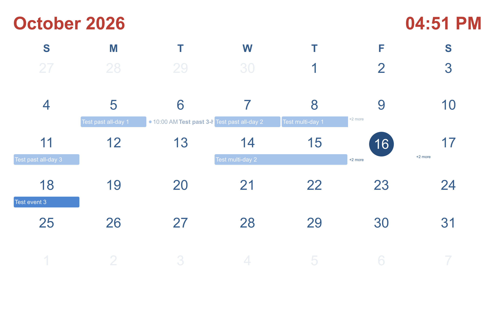
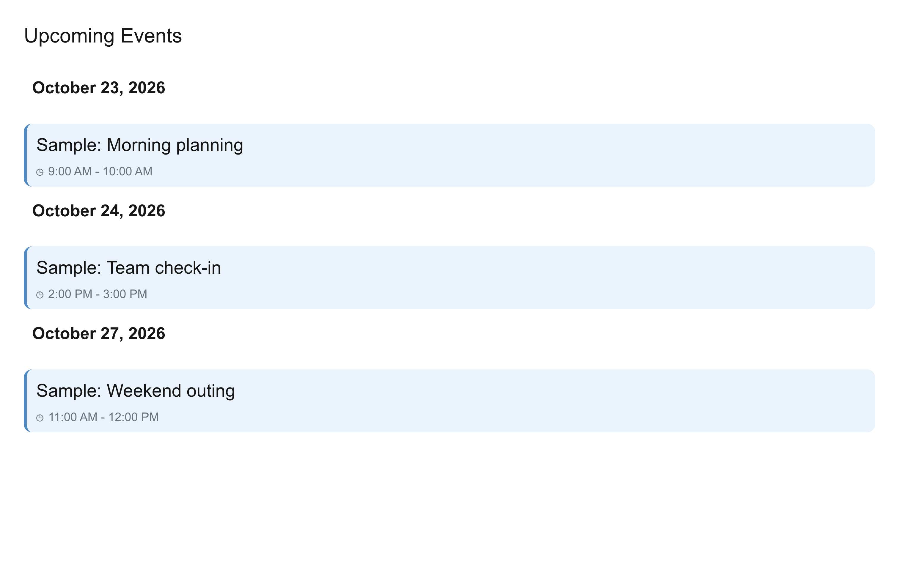
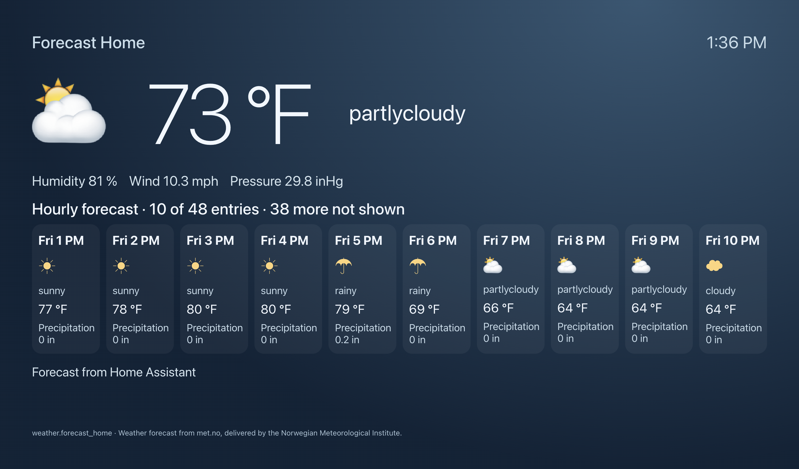

# Idle faces

After the inactivity timer expires, HA View shows a face. Press and hold the display to open the face chooser, swipe between choices, and tap one to show it. The eye button hides or shows a choice in the chooser.

## Clocks

*Clock 1*

*Clock 2*

## Calendar and events

*Calendar shows events from the calendars selected in Face Settings.*

*Upcoming Events lists events from the calendars selected in Face Settings. Sample events shown.*

## Weather

*Weather shows current conditions and a forecast from Home Assistant.*

[Face Settings](../settings/README.md) controls the inactivity timer, calendars, and automatic face changes.

[Screen guide](../README.md)
