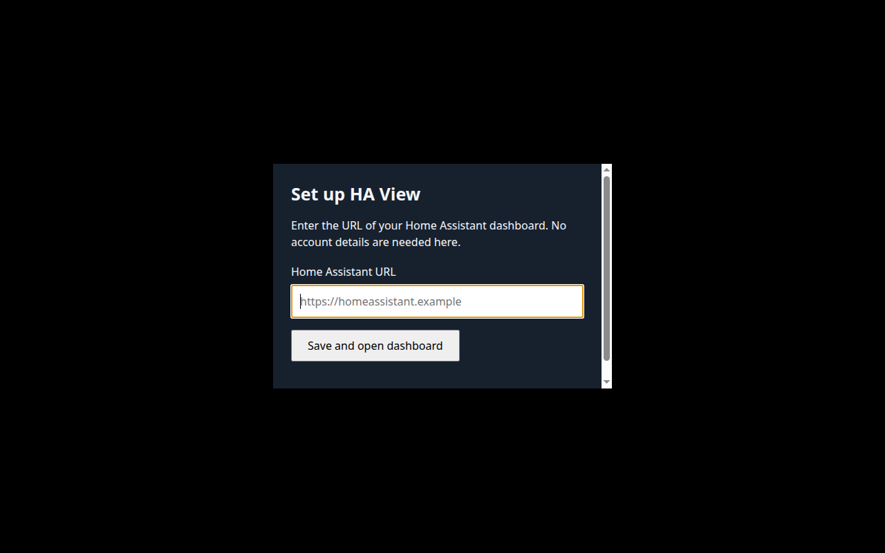

# Connect to Home Assistant

On first launch, HA View asks for your Home Assistant address — the same address you use in a web browser, for example `http://homeassistant.local:8123`. Enter it and select **Save and open dashboard**.

If Home Assistant asks you to sign in, follow its sign-in screen. Signing in happens inside Home Assistant itself, with your usual Home Assistant username and password.

HA View remembers the address, so next time it opens straight to your dashboard. To use a different address later, open HA View's settings and change it there.

Once you are connected, your [dashboard](../HA/README.md) is the main screen. When the display sits idle, an [idle face](../faces/README.md) takes over until you touch the screen again.

[Screen guide](../README.md) · [Dashboard](../HA/README.md)
