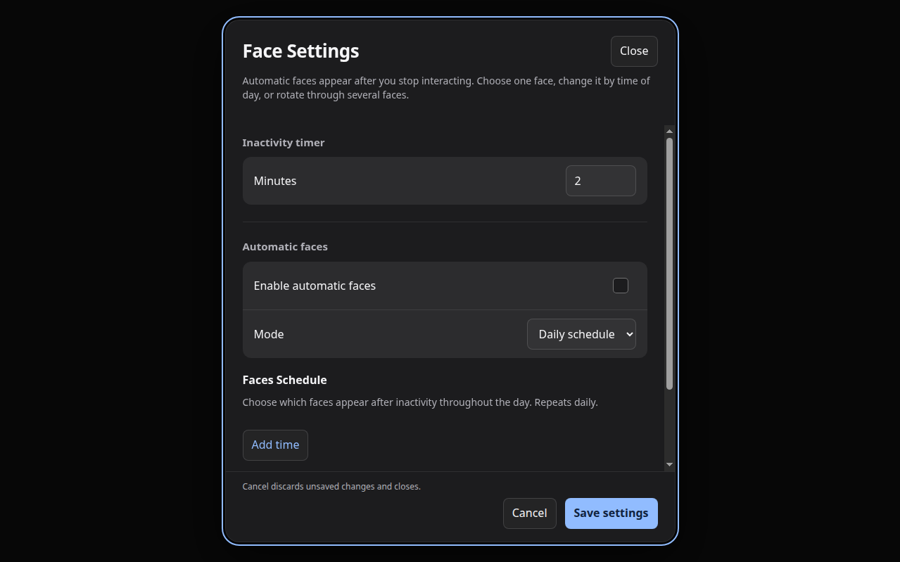

# Face Settings

Open the face chooser and select **Settings**, then **Face Settings**. Set the **Inactivity timer** to choose how long HA View waits before showing a face.

Enable **Automatic faces** to change what appears during the day:

- **Daily schedule** shows your chosen faces at specified times.
- **Rotating faces** moves through selected faces at your chosen interval.

Expand **Calendar** to select the calendars used by Calendar and Upcoming Events. Select **Save settings** when you finish. Weather uses a weather entity configured in Home Assistant.

The browser's gear opens its separate [browser settings](../browser/README.md).

[Screen guide](../README.md)
